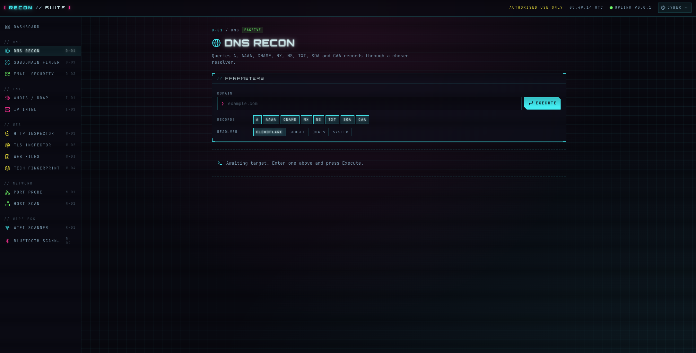

# Recon Suite

A collection of reconnaissance tools with a cyberpunk HUD interface. Built as a
Turborepo monorepo with a feature-driven architecture.



> For authorised security assessments only. Active modules connect directly to the
> target; only probe systems you own or have permission to test.

## Tools

| Code | Tool                     | Mode    | What it does                                                                                    |
| ---- | ------------------------ | ------- | ----------------------------------------------------------------------------------------------- |
| D-01 | DNS Recon                | passive | A, AAAA, CNAME, MX, NS, TXT, SOA, CAA via Cloudflare/Google/Quad9/system                        |
| D-02 | Subdomain Finder         | passive | Subdomains from certificate transparency logs (crt.sh)                                          |
| D-03 | Email Security           | passive | SPF (nested lookup count), DMARC, DKIM keys, MTA-STS, TLS-RPT, BIMI, with a grade               |
| D-04 | Zone Transfer            | active  | AXFR against every nameserver; flags servers that leak the zone                                 |
| D-05 | DNSSEC Check             | passive | DS/DNSKEY/RRSIG, algorithms, signature expiry; secure, insecure or bogus                        |
| D-06 | Subdomain Takeover       | active  | Dangling CNAMEs to deleted cloud resources (S3, Azure, Bitbucket, ...)                          |
| I-01 | WHOIS / RDAP             | passive | Registrar, lifecycle, status, nameservers; IP network ownership                                 |
| I-02 | IP Intel                 | passive | Reverse DNS + forward confirmation, ASN (Team Cymru), RDAP network, CDN/cloud provider          |
| I-03 | CVE Lookup               | passive | Known CVEs for a product and version from the NVD, CVSS and CISA KEV (needs NVD_API_KEY)        |
| I-04 | Org Cert Search          | passive | Domains of a company from certificate transparency, by organisation name                        |
| I-05 | Reverse IP               | passive | Other hostnames on the same IP, from SecurityTrails (needs SECURITYTRAILS_API_KEY)              |
| I-06 | Cloud Storage            | active  | Public or existing S3, GCS and Azure buckets with names derived from the domain                 |
| I-07 | Passive Exposure         | passive | Open ports, CVEs and tags from Shodan InternetDB, without contacting the target                 |
| I-08 | Dev Footprint            | passive | GitHub/GitLab organisation, npm scope, PyPI and Docker Hub presence, dependency confusion       |
| I-09 | DNSBL Reputation         | passive | Spamhaus, SpamCop, Barracuda, PSBL, UCEPROTECT, SURBL listings for an IP or domain              |
| W-01 | HTTP Inspector           | active  | Redirect chain, headers, security-header grade, disclosures                                     |
| W-02 | TLS Inspector            | active  | Protocol, cipher, certificate, SANs, chain, expiry                                              |
| W-03 | Web Files                | active  | robots.txt (notable paths), sitemap.xml, security.txt (RFC 9116 checks), humans.txt             |
| W-04 | Tech Fingerprint         | active  | Server, language, framework, CMS, CDN, libraries from headers, cookies and HTML                 |
| W-05 | Wayback URLs             | passive | Archived URLs: old endpoints, backup/config files, sensitive parameters                         |
| W-06 | CORS Check               | active  | Reflected, null and look-alike origins with credentials                                         |
| W-07 | TLS Audit                | active  | Accepted TLS versions and cipher suites, OCSP stapling, CT; graded                              |
| W-08 | JS Endpoints             | active  | API paths, hosts, exposed source maps and leaked keys in JavaScript                             |
| W-09 | Exposed Files            | active  | .git, .env, .DS_Store, server-status, actuator, config backups (content-verified)               |
| W-10 | Cookie Audit             | active  | Grades Set-Cookie flags: Secure, HttpOnly, SameSite, prefixes, Domain, lifetime                 |
| W-11 | HTTP Methods & Misconfig | active  | OPTIONS/TRACE, HTTP to HTTPS redirect, HSTS preload, error page leaks, default pages            |
| W-12 | WAF / CDN Detect         | active  | Cloudflare, Akamai, CloudFront, Fastly, Imperva, F5, ... from headers, cookies, block pages     |
| W-13 | Favicon Hash             | active  | Shodan mmh3, MD5, SHA-256 of the site icons, with Shodan/FOFA/Censys queries                    |
| W-14 | API Discovery            | active  | OpenAPI/Swagger specs with endpoint list, Swagger UI/ReDoc, GraphQL introspection               |
| W-15 | Dir Buster               | active  | Directory and file discovery from a wordlist, soft-404 filter, listings and backups flagged     |
| W-16 | Gobuster                 | active  | `gobuster dir` on the API host with installed wordlists (dirb, DirBuster, SecLists), time limit |
| N-01 | Port Probe               | active  | TCP connect check on preset or custom ports (max 64)                                            |
| N-02 | Host Scan                | local   | Live hosts, MACs and vendors on the scanner's subnet (`nmap -sn`)                               |
| N-03 | Banner Grab              | active  | Service greetings (SSH, SMTP, FTP, IMAP, POP3, MySQL) with product and version                  |
| N-04 | Nmap Scan                | active  | nmap TCP scan (top 100/1000 or custom ports) with service/version detection                     |
| N-05 | Network Scan             | active  | nmap ping sweep of a range (up to /22): live hosts, MACs, vendors, device guess                 |
| R-01 | WiFi Scanner             | local   | Nearby WiFi networks seen by the API host: SSID, band, channel, security, signal                |
| R-02 | Bluetooth Scanner        | local   | BLE advertisements + Classic inquiry: name, vendor, class, RSSI, services (macOS, Linux)        |

**Engagements** tie it together for real assessments: a history of every run with tags and run-to-run comparison, change monitoring (what changed
since the last run of each tool and target, with one-click re-runs), collected findings, notes, batch
runs over many targets, and a Markdown/JSON/CSV report export. There is no login: the UI and API
are meant for a single operator on a trusted network (the API listens on every interface, port
4000).

Results link to each other ("pivots"): a hostname found in DNS, CT logs or a certificate
can be opened in any other compatible tool with one click. Every tool also accepts
`?target=` in the URL, e.g. `/tools/dns?target=example.com`. Two themes are built in:
**Cyber** (default) and **Nothing** (monochrome, dot-matrix), switchable in the top bar.

## Documentation

| Page                                       | Contents                                              |
| ------------------------------------------ | ----------------------------------------------------- |
| [Getting started](docs/getting-started.md) | Install, development, running, troubleshooting        |
| [Using the UI](docs/using-the-ui.md)       | Tool pages, pivots, deep links, themes                |
| [Tools reference](docs/tools.md)           | Every tool with options, data sources and limits      |
| [HTTP API](docs/api.md)                    | Endpoints, response envelope, errors, `curl` examples |
| [Configuration](docs/configuration.md)     | Environment variables                                 |
| [Local tools setup](docs/local-tools.md)   | WiFi, Bluetooth, Host Scan per OS; macOS helper       |
| [Security model](docs/security.md)         | Target resolution, limits, deployment advice          |
| [Architecture](docs/architecture.md)       | Monorepo, feature slices, request flow                |

## Stack

| Path              | Package         | Stack                                                                  |
| ----------------- | --------------- | ---------------------------------------------------------------------- |
| `apps/api`        | `@recon/api`    | NestJS 12 (ESM), Zod validation, undici, Drizzle + node:sqlite, Vitest |
| `apps/web`        | `@recon/web`    | Vite, React 19, TanStack Router + Query, Tailwind 4, shadcn/ui         |
| `packages/shared` | `@recon/shared` | Zod schemas, types and tool catalog used by both apps                  |

## Getting started

Requirements: Node 24+, npm 11.

```sh
npm install
npm run dev        # api http://localhost:4000, web http://localhost:5173
```

```sh
npm run build | typecheck | lint | test
npm run test:e2e -w @recon/api
npm start          # build, then run api :4000 + web :4173 in the background
npm stop
```

Configuration: see `apps/api/.env.example` and `apps/web/.env.example`.

> **Local tools** (WiFi, Bluetooth, Host Scan) inspect the machine running the API. On macOS run `npm run setup:macos-helper` once. Details per OS:
> [docs/local-tools.md](docs/local-tools.md).

## Security model

- Every connection to a user-supplied target is resolved by `TargetGuardService`. There is no
  private-range block: tools can reach loopback, your LAN and cloud metadata addresses.
- Timeouts (except nmap scans), response size limits and port count limits apply to all
  tools. There is no rate limit.
- No login: anyone who can reach the API can use it, so keep it on your machine or a private
  network. See
  [docs/security.md](docs/security.md).

## Architecture & agentic development

See **[AGENTS.md](AGENTS.md)** for the architecture, conventions, security rules and the
definition of done. `CLAUDE.md` files import it so Claude Code loads it automatically.

- `apps/api/AGENTS.md`: backend rules (plus NestJS ecosystem notes)
- `apps/web/AGENTS.md`: frontend structure and the cyberpunk design system
- `.claude/skills/add-recon-tool/`: step-by-step skill with templates for adding a new tool

To add a tool with an agent, ask e.g. _"Add a security.txt checker tool"_. The
`add-recon-tool` skill guides it through shared contract, API module, web feature and checks.
