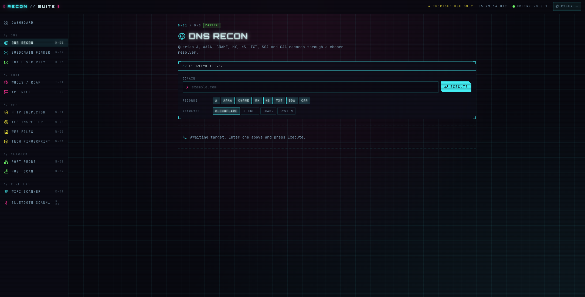

# Recon Suite documentation

Recon Suite is a self-hosted collection of reconnaissance tools for authorised security
assessments. A NestJS API runs the lookups and scans; a React UI presents the results and lets
you pivot from one finding to the next tool.

> Only test systems you own or have written permission to test. Active tools connect directly
> to the target and may show up in its logs or trigger alerts.

## Contents

| Page                                  | For                                                             |
| ------------------------------------- | --------------------------------------------------------------- |
| [Getting started](getting-started.md) | Install, run in development, run with containers, first scan    |
| [Using the UI](using-the-ui.md)       | Dashboard, tool pages, pivots, deep links, themes               |
| [Tools reference](tools.md)           | What every tool does, its options, data sources and limits      |
| [HTTP API](api.md)                    | Endpoints, request and response format, errors, `curl` examples |
| [Configuration](configuration.md)     | Environment variables for the API, web app and containers       |
| [Local tools setup](local-tools.md)   | WiFi, Bluetooth and Host Scan per OS, macOS helper, containers  |
| [Security model](security.md)         | Target resolution, limits, deployment advice                    |
| [Architecture](architecture.md)       | Monorepo layout, feature slices, request flow, adding a tool    |

Contributor and agent rules (conventions, definition of done) live in
[`AGENTS.md`](../AGENTS.md).
