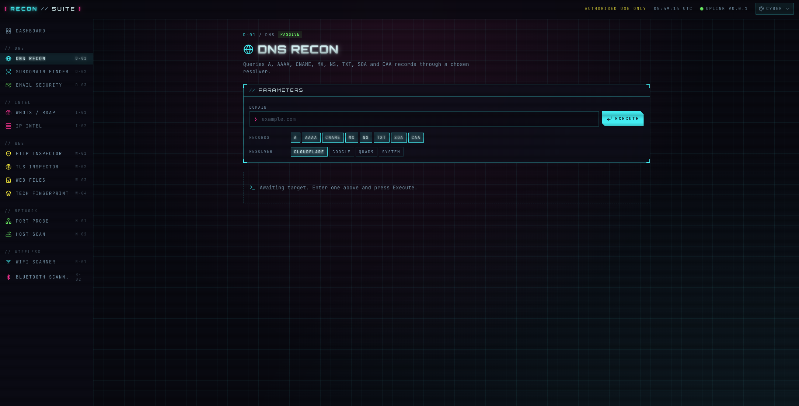

# Using the UI



## Layout

- **Top bar:** logo (back to the dashboard), UTC clock, API status ("uplink") and the theme
  switcher.
- **Sidebar:** every tool grouped by category (DNS, Intel, Web, Network, Wireless) with its
  code, e.g. `D-01`. On small screens it becomes a horizontal strip under the top bar.
- **Dashboard:** tool cards with passive/active badges and a quick-target field.

## Tool pages

Every remote tool page has the same structure:

1. **Header** with code, category and a `PASSIVE` or `ACTIVE` badge. Active tools also show an
   authorisation notice: they connect to the target itself.
2. **Parameters panel:** the target field plus tool options (record types, resolver, ports,
   DKIM selectors, ...). Press **Execute** or Enter.
3. **Output:** a loading terminal while the tool runs, then the results. A meta bar shows the
   target, start time and duration. The **Raw JSON** tab shows the full API response, with a
   copy button.

Local tools (WiFi, Bluetooth, Host Scan) have no target field. They show a scan panel instead,
and options such as the network interface.

## Pivots

Wherever a result contains a hostname, IP address or URL, small icons next to it open that
value in another compatible tool. For example: an MX host from Email Security opens in DNS
Recon, TLS Inspector or IP Intel; a sitemap URL from Web Files opens in HTTP Inspector or Tech
Fingerprint. Which tools are offered depends on the kind of value (domain, IP or URL).

## Deep links

Every remote tool accepts `?target=` and runs immediately when opened with it:

```
http://localhost:5173/tools/dns?target=example.com
http://localhost:5173/tools/ip-intel?target=1.1.1.1
http://localhost:5173/tools/web-files?target=https://example.com
```

Use this for bookmarks or to link findings in a report.

## Themes

The theme switcher in the top bar offers:

| Theme     | Look                                                                                                                                    |
| --------- | --------------------------------------------------------------------------------------------------------------------------------------- |
| `Cyber`   | Default. Neon cyberpunk HUD: glow, scanlines, clipped corners, Orbitron headings.                                                       |
| `Nothing` | Inspired by the Nothing design language: true black, white type, one red accent, dot-matrix headings, dot grid, rounded cards, no glow. |

The choice is stored in the browser (`localStorage`, key `recon-theme`) and applied before the
page renders. Colours keep their meaning in every theme: green is pass/success, yellow is a
warning, red/magenta is an error or critical finding.
